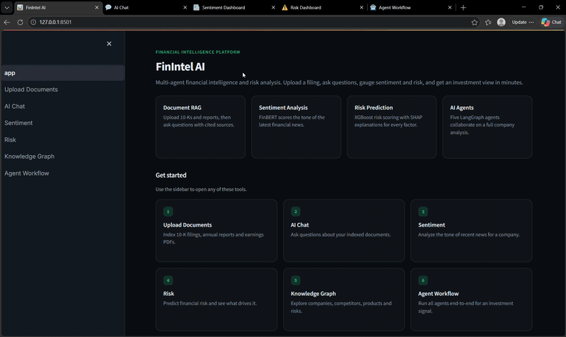

# FinIntel AI

Multi-agent financial intelligence and risk analysis platform. Upload a 10-K or annual report, ask questions with cited answers, score news sentiment and financial risk, and run five AI agents end-to-end to get an investment signal.



## Features

- **Document RAG:** index PDF filings and chat with them; answers cite their sources (hybrid embedding + keyword retrieval).
- **Sentiment analysis:** FinBERT scores the tone of recent financial news.
- **Risk prediction:** XGBoost risk scoring with SHAP explanations of each factor.
- **Knowledge graph:** interactive graph of companies, competitors, products and risks.
- **Agent workflow:** five LangGraph agents (document, risk, news, summary, recommendation) produce an executive summary and a Bullish/Neutral/Bearish signal.

## Tech stack

Python 3.11 · Streamlit · LangChain / LangGraph · Groq LLM · ChromaDB · sentence-transformers · FinBERT (Transformers, PyTorch) · XGBoost · SHAP · NetworkX / PyVis · Plotly

## How to run

```bash
# 1. Clone and enter the project
git clone https://github.com/prakritiie/fintelAI.git
cd fintelAI

# 2. Create a virtual environment and install dependencies
python -m venv .venv
.venv\Scripts\activate          # Windows  (macOS/Linux: source .venv/bin/activate)
pip install -r requirements.txt

# 3. Add your API keys
copy .env.example .env          # macOS/Linux: cp .env.example .env
# then edit .env and set GROQ_API_KEY (required) and NEWS_API_KEY (optional)

# 4. Start the app (run from the project root)
streamlit run dashboard/app.py
```

Open http://localhost:8501. Start with **Upload Documents** to index a PDF, then try **AI Chat**.

Notes: the first run downloads the embedding and FinBERT models, and the risk model trains itself automatically if `risk/saved_models/` is missing.

## Project structure

```
agents/      LangGraph agents and workflow
core/        PDF processing, embeddings, vector store
rag/         Retriever, prompts, QA chain
sentiment/   FinBERT + news fetching
risk/        XGBoost model, SHAP explainer
graph/       Knowledge graph builder and visualizer
dashboard/   Streamlit app and pages
```
